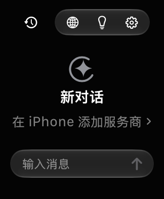
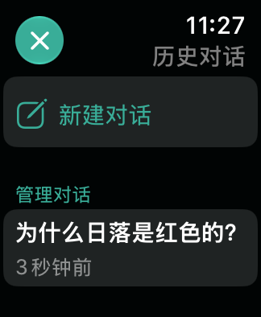
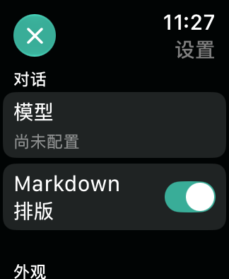

# Arc Watch AI

为 Apple Watch 设计的原生 AI 聊天应用，附带 iPhone 配置和聊天界面。支持 watchOS 10、iOS 17 及以上版本，使用 SwiftUI、Watch Connectivity 和 Keychain。

  
  
  

## 第一次使用

1. 在 iPhone「服务商」中添加 OpenAI、Anthropic 或 DeepSeek，填写 Base URL 和 API Key。同一协议可添加多个账户或兼容网关。Base URL 可以带网关自己的路径前缀。
2. 点「自动检测模型」选取远端提供的模型，或手动输入模型编号和显示名。例如，填写 `gpt-6-sol` 和 `GPT 6 Sol`，发给服务器的是前者，两端菜单显示后者。
3. 打开配对的 Apple Watch 应用，等待配置送达，在新对话中选择模型。之后手表可通过自己的网络直接与服务商对话。

## 在手表上聊天

- 聊天页左上角是独立的历史按钮，右侧胶囊从左到右是联网搜索、思考和设置。在 watchOS 26 及以上使用系统 Liquid Glass。
- 聊天页隐藏时间，为正文腾出空间。点历史可以新建或删除对话。每次冷启动进入空白新对话，发送第一条消息后才计入历史。
- 底部是一条 28 点高的输入栏。点左侧调用手表系统输入面板，可使用设备和语言支持的听写、手写或键盘。点右侧箭头发送，等待回复时可停止。
- 用户消息显示为右对齐气泡，AI 回复直接排在正文里。Markdown 支持标题、列表、引用、代码块、表格和链接，可在设置中切换为原文。
- 两端均可设置显示模式及主题色。iPhone 提供完整选色器，手表提供预设和色相调节。手表浅色模式应用于聊天画布及应用界面，系统输入面板和状态栏由 watchOS 管理。

## 网络与同步

| 服务商 | 对话与模型 | 联网搜索和思考 |
| --- | --- | --- |
| OpenAI | Responses、`/models`。普通对话可回退到仅提供 Chat Completions 的兼容网关 | Responses `web_search`，按模型设置 reasoning effort |
| DeepSeek | 普通对话使用 Chat Completions，模型列表来自 `/models` | 联网使用 Responses。`deepseek-flash` 可自主使用 `deepseek_web_search`，`deepseek-v4-pro` 使用 `web_search` |
| Anthropic | Messages、带分页的模型列表 | Claude 服务端网页搜索，按模型设置 adaptive thinking 或思考预算 |

模型、网关及账户可能只支持部分功能。服务商返回的错误会显示在当前界面。接口细节见 [OpenAI 网页搜索](https://developers.openai.com/api/docs/guides/tools-web-search)、[DeepSeek 联网工具](https://api-docs.deepseek.com/guides/web_tools/)、[DeepSeek Responses](https://api-docs.deepseek.com/guides/responses_api/) 和 [Anthropic Messages](https://platform.claude.com/docs/en/api/messages/create)。

iPhone 管理服务商和密钥，两端各自使用 Keychain 保存密钥。历史及偏好经 Watch Connectivity 同步。两端离线追加的消息按标识符合并，删除记录会传播到另一台设备。

## 构建

直接打开 `ArcWatchAI.xcodeproj`。在两个 target 的 Signing & Capabilities 中选择自己的开发团队，选择配对的 iPhone 和 Apple Watch，运行 `ArcWatchAI`。单独运行手表使用 `ArcWatch` scheme。真机用的 Base URL 应能从手表访问。

仓库包含可直接打开的 Xcode 工程。如需从 `project.yml` 重新生成，可运行 `xcodegen generate`。在 macOS 运行 `swift test -j 1` 可验证服务商请求、响应解析和历史合并。
